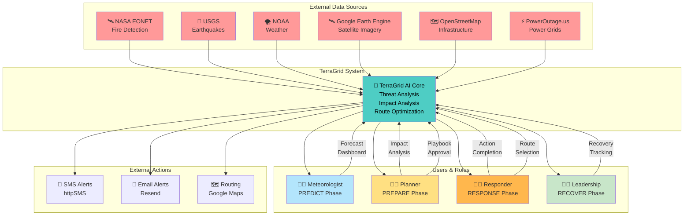

# Process Flow & Use-Case Diagrams
## For AI Builder Cup Submission

---

## **Slide 6A: Process Flow Diagram**

### **How TerraGrid Operates: End-to-End Workflow**

```mermaid
graph TD
    A["🌍 Natural Disaster Detected<br/>(Satellite / Seismic Data)"] --> B["📊 PREDICT Phase<br/>7-Day Forecast & Risk Assessment"]
    
    B --> C["🎯 Infrastructure Vulnerability<br/>Mapping & Threat Scoring"]
    C --> D{["Threshold<br/>Exceeded?"]}
    
    D -->|Yes| E["📋 PREPARE Phase<br/>AI Impact Analysis"]
    D -->|No| Z["⏰ Monitor & Update<br/>Forecast"]
    Z --> B
    
    E --> F["🤖 AI Recommends:<br/>- Resource Positioning<br/>- Playbook Generation<br/>- Stakeholder Tasks"]
    
    F --> G{["Disaster<br/>Occurring?"]}
    G -->|No| H["✅ Preparedness Complete<br/>Monitor & Update"]
    H --> B
    G -->|Yes| I["🚨 RESPONSE Phase<br/>Activated"]
    
    I --> J["📡 Real-Time Intelligence<br/>Multi-Source Data Feeds"]
    J --> K["🛣️ Dynamic Evacuation<br/>Route Optimization<br/>Recalc every 30 sec"]
    
    K --> L["📢 Multi-Channel Alerts<br/>SMS + Email Broadcast<br/>Personalized per Location"]
    L --> M["👥 Responder Action Queue<br/>AI-Prioritized Tasks"]
    
    M --> N["✔️ RESPONSE Phase<br/>Ongoing Coordination"]
    N --> O{["Disaster<br/>Cleared?"]}
    
    O -->|No| P["🔄 Continue Response<br/>Update Intelligence"]
    P --> J
    O -->|Yes| Q["🔍 RECOVER Phase<br/>Damage Assessment"]
    
    Q --> R["🛰️ Before/After Satellite<br/>Comparison"]
    R --> S["📊 Infrastructure<br/>Restoration Tracking"]
    
    S --> T["📈 Lessons Learned<br/>Outcome Validation"]
    T --> U["🔁 Feedback Loop<br/>Improve PREDICT Model"]
    U --> B
    
    style A fill:#ff6b6b
    style B fill:#4ecdc4
    style E fill:#ffe66d
    style I fill:#ff6b6b
    style Q fill:#95e1d3
    style U fill:#4ecdc4
```

---

## **Slide 6B: Use-Case Diagram**

### **Actors, System Interactions, and Use Cases**



---

## **Diagram Prompts for AI Diagram Generators**

### **Prompt 1: Process Flow (For Eraser.io / Lucidchart / Draw.io)**

```
Create a professional process flow diagram for a disaster intelligence platform called TerraGrid.

Timeline and flow:
1. Start: Natural disaster detected (satellite/seismic data detected)
2. PREDICT Phase: 
   - 7-day forecast dashboard shows risk escalation
   - Infrastructure vulnerability mapping
   - AI threat scoring
   - Threshold check: if no threat, loop back to monitoring
   
3. PREPARE Phase (if threshold exceeded):
   - AI impact analysis (buildings exposed, population at risk)
   - AI recommends resource positioning
   - Automated playbook generation
   - Stakeholder task assignment
   - Preparedness decision: If disaster doesn't occur, loop back to PREDICT. If disaster occurs, move to RESPONSE
   
4. RESPONSE Phase (disaster occurs):
   - Real-time incident dashboard activates
   - Multi-source data feeds ingestion
   - Dynamic evacuation route optimization (recalculated every 30 seconds)
   - Multi-channel alerts broadcast (SMS, email, personalized per location)
   - Responder action queue with AI-prioritized tasks
   - Ongoing coordination until disaster cleared
   
5. RECOVER Phase:
   - Before/after satellite imagery comparison
   - Infrastructure restoration tracking
   - Damage extent quantification
   - Lessons learned generation
   - Feedback loop: outcomes feed back into improving PREDICT model for next cycle

Design requirements:
- Use color coding: Blue for PREDICT, Yellow for PREPARE, Red for RESPONSE, Green for RECOVER
- Show decision points (diamond shapes)
- Show feedback loops (arrows returning to earlier phases)
- Professional, minimalist design
- Suitable for business/technical presentation
```

---

### **Prompt 2: Use-Case Diagram (For Eraser.io / Lucidchart / Draw.io)**

```
Create a professional use-case diagram for TerraGrid disaster intelligence platform.

Include:

**External Systems (on left side):**
- NASA EONET (fire detection)
- USGS (earthquake data)
- NOAA (weather data)
- Google Earth Engine (satellite imagery)
- OpenStreetMap (infrastructure mapping)
- PowerOutage.us (power grid data)

**Main System (center):**
- TerraGrid AI Core with sub-functions:
  - Threat Analysis
  - Impact Analysis
  - Route Optimization
  - Decision Lineage Tracking

**Users/Actors (on right side):**
- Meteorologist (PREDICT phase interactions)
- Planner (PREPARE phase - impact analysis, playbook approval)
- Responder (RESPONSE phase - action selection, route selection)
- Leadership/Administrator (RECOVER phase - recovery tracking)

**External Actions (far right):**
- SMS Alert System (httpSMS)
- Email Alert System (Resend)
- Routing Service (Google Maps)

**Connections:**
- All external data sources connect to TerraGrid AI Core
- Each actor connects to TerraGrid for their specific use cases
- TerraGrid connects to alert systems and routing services
- Show labeled interactions (Forecast Dashboard, Impact Analysis, Playbook Approval, Action Completion, etc.)

Design requirements:
- Professional business format
- Clear actor boundaries and system boundaries
- Color-coded by role (blue for meteorologist, yellow for planner, orange for responder, green for leadership)
- Minimalist, clean design
- Suitable for C-suite/technical presentation
```

---

## **How to Use These Diagrams**

### **Option 1: Use Mermaid Directly (Free, Automatic Rendering)**
1. Copy the Mermaid code from above
2. Paste into mermaid.live (https://mermaid.live)
3. Export as PNG/SVG
4. Include PNG in PDF submission

### **Option 2: Use AI Diagram Generators (Custom Styling)**
1. Copy the **Prompt 1** or **Prompt 2** text
2. Paste into Eraser.io / Lucidchart / Draw.io
3. Let AI generate the diagram
4. Customize as needed
5. Export as PNG/SVF for PDF

### **Option 3: Professional Design Tool**
1. Use the Mermaid code as reference
2. Recreate in PowerPoint / Figma / Adobe Illustrator for full design control
3. Export as PNG/SVG

---

**End of Slide 6**
