# Architecture Diagram of the Proposed Solution
## For AI Builder Cup Submission

---

## **Slide 7: Technical Architecture**

### **TerraGrid System Architecture**

```mermaid
graph TB
    subgraph "Data Sources Layer"
        NASA["🛰️ NASA EONET<br/>Fire Detection API"]
        USGS["📍 USGS Earthquake<br/>API"]
        NOAA["🌪️ NOAA Weather<br/>API"]
        OWM["🌤️ OpenWeatherMap<br/>5-Day Forecast"]
        GEE["🛰️ Google Earth Engine<br/>Satellite Imagery"]
        OSM["🗺️ OpenStreetMap<br/>Infrastructure"]
        PWR["⚡ PowerOutage.us<br/>Power Grid Data"]
    end
    
    subgraph "Backend Layer - FastAPI"
        POLL["📥 Data Ingestion<br/>Pipelines<br/>Poll every 5-15 min"]
        CACHE["💾 Redis Cache<br/>Real-time Data"]
        API["🔌 REST API<br/>Endpoints"]
        WS["🔗 WebSocket Server<br/>Real-time Updates"]
    end
    
    subgraph "AI & Processing Layer"
        THREAT["🤖 Threat Analysis<br/>Vertex AI Embeddings"]
        IMPACT["📊 Impact Analysis<br/>Exposure Quantification"]
        PLAYBOOK["📋 Playbook Generator<br/>Gemini 1.5 Flash"]
        ROUTE["🛣️ Route Optimization<br/>OR-Tools Algorithm"]
        LINEAGE["🔍 Decision Lineage<br/>Audit Trail Tracker"]
    end
    
    subgraph "Database Layer - Google Cloud"
        PSQL["🗄️ Cloud SQL<br/>PostgreSQL<br/>Transactional Data"]
        FIRE["🔥 Firestore<br/>Document Store<br/>Incidents & Playbooks"]
        STORAGE["☁️ Cloud Storage<br/>Satellite Imagery<br/>Artifacts"]
    end
    
    subgraph "Frontend Layer - Vue 3"
        PREDICT_UI["📊 PREDICT UI<br/>Forecast Dashboard<br/>Threat Scoring"]
        PREPARE_UI["📋 PREPARE UI<br/>Impact Analysis<br/>Resource Positioning"]
        RESPONSE_UI["🚨 RESPONSE UI<br/>Incident Command<br/>Evacuation Routing"]
        RECOVER_UI["🔍 RECOVER UI<br/>Damage Assessment<br/>Recovery Tracking"]
    end
    
    subgraph "External Actions Layer"
        SMS["📱 SMS Alerts<br/>httpSMS API"]
        EMAIL["📧 Email Alerts<br/>Resend API"]
        MAPS["🗺️ Routing Service<br/>Google Maps API"]
        PUBSUB["📢 Pub/Sub<br/>Event Streaming"]
    end
    
    subgraph "Deployment & Infra"
        RUN["☁️ Google Cloud Run<br/>Auto-Scaling Backend"]
        AUTH["🔐 Secret Manager<br/>Credentials"]
        MONITOR["📈 Cloud Logging<br/>Monitoring & Alerts"]
    end
    
    NASA --> POLL
    USGS --> POLL
    NOAA --> POLL
    OWM --> POLL
    GEE --> POLL
    OSM --> POLL
    PWR --> POLL
    
    POLL --> CACHE
    CACHE --> API
    CACHE --> WS
    
    API --> THREAT
    API --> IMPACT
    API --> PLAYBOOK
    API --> ROUTE
    API --> LINEAGE
    
    THREAT --> PSQL
    IMPACT --> PSQL
    PLAYBOOK --> FIRE
    ROUTE --> PSQL
    LINEAGE --> PSQL
    
    API --> PREDICT_UI
    WS --> PREDICT_UI
    API --> PREPARE_UI
    WS --> PREPARE_UI
    API --> RESPONSE_UI
    WS --> RESPONSE_UI
    API --> RECOVER_UI
    WS --> RECOVER_UI
    
    PREDICT_UI --> SMS
    PREDICT_UI --> EMAIL
    PREPARE_UI --> SMS
    PREPARE_UI --> EMAIL
    RESPONSE_UI --> SMS
    RESPONSE_UI --> EMAIL
    RESPONSE_UI --> MAPS
    
    THREAT --> PUBSUB
    IMPACT --> PUBSUB
    PLAYBOOK --> PUBSUB
    ROUTE --> PUBSUB
    
    PUBSUB --> WS
    
    API --> RUN
    WS --> RUN
    RUN --> AUTH
    RUN --> MONITOR
    
    PSQL --> RUN
    FIRE --> RUN
    STORAGE --> RUN
    
    style NASA fill:#ff9999
    style USGS fill:#ff9999
    style NOAA fill:#ff9999
    style OWM fill:#ff9999
    style GEE fill:#ff9999
    style OSM fill:#ff9999
    style PWR fill:#ff9999
    
    style POLL fill:#ffcccc
    style CACHE fill:#ffcccc
    style API fill:#ffcccc
    style WS fill:#ffcccc
    
    style THREAT fill:#ffffcc
    style IMPACT fill:#ffffcc
    style PLAYBOOK fill:#ffffcc
    style ROUTE fill:#ffffcc
    style LINEAGE fill:#ffffcc
    
    style PSQL fill:#ccffcc
    style FIRE fill:#ccffcc
    style STORAGE fill:#ccffcc
    
    style PREDICT_UI fill:#ccddff
    style PREPARE_UI fill:#ccddff
    style RESPONSE_UI fill:#ccddff
    style RECOVER_UI fill:#ccddff
    
    style SMS fill:#ffddcc
    style EMAIL fill:#ffddcc
    style MAPS fill:#ffddcc
    style PUBSUB fill:#ffddcc
    
    style RUN fill:#e6ccff
    style AUTH fill:#e6ccff
    style MONITOR fill:#e6ccff
```



---

## **Architecture Layers Explained**

### **Layer 1: Data Sources (Top)**
**Purpose:** Collect real-world disaster and infrastructure data

| Source | Data Type | Refresh Rate | Use Case |
|--------|-----------|--------------|----------|
| **NASA EONET** | Fire detection, active events | Real-time | PREDICT: Fire threat identification |
| **USGS** | Earthquake location, magnitude, depth | Real-time | PREDICT: Seismic threat assessment |
| **NOAA** | Historical weather patterns, alerts | Daily | PREDICT: Pattern analysis |
| **OpenWeatherMap** | 5-day forecasts per city | Hourly | PREDICT: Weather forecasting |
| **Google Earth Engine** | Satellite imagery (Sentinel-1, Landsat) | Daily/Weekly | PREDICT: Flood detection, RECOVER: Damage assessment |
| **OpenStreetMap** | Buildings, power grids, hospitals, roads | Updated | PREPARE: Infrastructure mapping |
| **PowerOutage.us** | Power grid status, cascade failures | Real-time | PREDICT: Power disruption modeling |

---

### **Layer 2: Backend (FastAPI Python)**
**Purpose:** Ingest data, cache, expose via API/WebSocket

| Component | Function | Technology |
|-----------|----------|-----------|
| **Data Ingestion Pipelines** | Poll external APIs every 5-15 min, handle failures | Python async/await |
| **Redis Cache** | Store latest data for sub-second retrieval | Redis in-memory |
| **REST API** | Expose backend functions to frontend | FastAPI + Pydantic |
| **WebSocket Server** | Real-time push updates (no polling) | FastAPI WebSockets |

**Key Feature:** Auto-retry logic; if API fails, use cached data + confidence flag

---

### **Layer 3: AI & Processing**
**Purpose:** Transform data into actionable intelligence

| Engine | Function | Technology | Output |
|--------|----------|-----------|--------|
| **Threat Analysis** | Score disaster likelihood + intensity | Vertex AI Embeddings | Confidence: 0.0-1.0 |
| **Impact Analysis** | Quantify exposed buildings, population, infrastructure | Custom algorithm + Vertex AI | Impact report: Buildings/people at risk |
| **Playbook Generator** | Create action plans per disaster type/location | Gemini 1.5 Flash | Structured JSON playbook |
| **Route Optimization** | Calculate evacuation paths accounting for hazards | Google OR-Tools | Multi-route with time estimates |
| **Decision Lineage** | Log every recommendation with source data + outcome | Custom tracker | Audit trail for validation |

---

### **Layer 4: Database (Google Cloud Storage)**
**Purpose:** Persist transactional data and documents

| Database | Data Type | Why This Choice |
|----------|-----------|-----------------|
| **Cloud SQL (PostgreSQL)** | Transactional (events, incidents, decisions, user actions) | ACID compliance, strong consistency |
| **Firestore** | Documents (incidents, playbooks, alerts, recovery tracking) | Scalable, real-time sync, nested data |
| **Cloud Storage** | Imagery, exports, artifacts | Large binary files, CDN delivery |

**Data Flow:** Backend writes to both; frontend reads from both

---

### **Layer 5: Frontend (Vue 3 + Vite)**
**Purpose:** Present data and recommendations to users

| Phase | UI Components | Real-Time Updates |
|-------|---------------|-------------------|
| **PREDICT** | Forecast dashboard, risk timeline, threat map | WebSocket |
| **PREPARE** | Impact analysis, resource positioning, playbook editor | WebSocket |
| **RESPONSE** | Incident dashboard, evacuation routing, action queue | WebSocket (sub-30 sec) |
| **RECOVER** | Before/after satellite, restoration tracking, lessons learned | WebSocket |

**Key Feature:** Phase-adaptive (users see only their phase); responsive (mobile-first design)

---

### **Layer 6: External Actions**
**Purpose:** Broadcast alerts and routing decisions

| Service | Function | Volume | Cost |
|---------|----------|--------|------|
| **httpSMS** | Send SMS to vulnerable populations | 1000s per event | Free tier: 200/month |
| **Resend** | Send email with map attachments | 1000s per event | Free tier: 3000/month |
| **Google Maps** | Geocoding, routing, traffic | Per request | $7/1000 requests |
| **Pub/Sub** | Event streaming to external systems | Internal use | Included in Cloud Run |

---

### **Layer 7: Deployment & Infrastructure**
**Purpose:** Auto-scale, secure, monitor production system

| Component | Function | Benefit |
|-----------|----------|---------|
| **Google Cloud Run** | Serverless backend auto-scaling | 0 → 10K users/min, pay-per-use |
| **Secret Manager** | Store API keys, database credentials | Never hardcoded; rotatable |
| **Cloud Logging** | Centralized logging + alerting | Troubleshoot issues in production |
| **Cloud Monitoring** | Performance metrics, uptime tracking | 99.9% SLA monitoring |

---

## **Data Flow Example: Flood Event Response**

```
1. Satellite detects flood extent
   ↓
2. Earth Engine processes imagery
   ↓
3. Ingestion pipeline fetches result, caches
   ↓
4. Impact Analysis engine calculates: "1,247 buildings exposed, 87,000 population"
   ↓
5. Route Optimization calculates: "Evacuate via Highway 3 (saves 15 min)"
   ↓
6. Decision Lineage logs: Why this recommendation? What data? Confidence: 92%
   ↓
7. Responder receives prioritized action in RESPONSE UI
   ↓
8. Responder approves evacuation
   ↓
9. SMS/Email alerts broadcast to 87,000 people instantly
   ↓
10. WebSocket updates all users: Evacuation in progress
   ↓
11. Post-event: Damage assessment satellites compare before/after
   ↓
12. Recovery tracking updates restoration milestones
   ↓
13. Lessons learned: "Model predicted 1,247; actual was 1,223 = 98% accuracy"
```

---

## **Scalability & Reliability**

### **Auto-Scaling**
- **Cloud Run:** Scales from 0 to 1000+ concurrent users in seconds
- **Database:** Cloud SQL reads scale via replicas; Firestore scales automatically
- **WebSocket:** Pub/Sub handles 1000s of concurrent connections

### **Resilience**
- **API Failures:** Cached data used with confidence flags
- **Database Failures:** Automatic failover, point-in-time recovery
- **Network Issues:** Offline mode for mobile responders

### **Performance**
- **Data Freshness:** 5-15 min ingestion cycle (disaster detection to dashboard: <2 min)
- **Route Optimization:** Recalculated every 30 sec with latest hazard data
- **Alert Delivery:** SMS/Email sent in <1 min to reach all recipients

---

## **Technology Stack Summary**

| Category | Technology | Rationale |
|----------|-----------|-----------|
| **Cloud Provider** | Google Cloud Platform | Native Earth Engine, Vertex AI, scalability |
| **Backend** | FastAPI (Python 3.11) | Async, modern, fast, great for real-time |
| **Frontend** | Vue 3 + Vite | Reactive, lightweight, responsive |
| **Database** | PostgreSQL + Firestore | SQL for consistency, NoSQL for scalability |
| **Cache** | Redis | Sub-second data access |
| **AI/ML** | Vertex AI + Gemini 1.5 Flash | Pre-trained models, no ML expertise needed |
| **Geospatial** | Google Earth Engine + OR-Tools | Satellite processing + route optimization |
| **Real-Time** | WebSocket + Pub/Sub | Live updates without polling |
| **Deployment** | Cloud Run + Secret Manager | Serverless, secure, auto-scaling |
| **Monitoring** | Cloud Logging + Cloud Monitoring | Production observability |

---

## **Architecture Prompt for Custom Design (Eraser.io / Lucidchart)**

```
Create a professional 3-tier system architecture diagram for TerraGrid disaster intelligence platform.

**Left side - Data Sources:**
- NASA EONET (fire detection)
- USGS (earthquakes)
- NOAA (weather)
- OpenWeatherMap (forecasts)
- Google Earth Engine (satellite)
- OpenStreetMap (infrastructure)
- PowerOutage.us (power grids)

**Middle - Processing Stack:**
Top tier (Data Ingestion):
- FastAPI backend
- Data ingestion pipelines (poll APIs)
- Redis cache

Middle tier (AI/Processing):
- Threat Analysis (Vertex AI)
- Impact Analysis
- Playbook Generator (Gemini)
- Route Optimization (OR-Tools)
- Decision Lineage Tracking

Database tier:
- Cloud SQL (PostgreSQL) - transactional
- Firestore - documents
- Cloud Storage - imagery

**Right side - Frontend & Actions:**
Frontend:
- PREDICT UI (Vue 3)
- PREPARE UI (Vue 3)
- RESPONSE UI (Vue 3)
- RECOVER UI (Vue 3)

External Actions:
- SMS alerts (httpSMS)
- Email alerts (Resend)
- Routing (Google Maps)
- Event streaming (Pub/Sub)

**Infrastructure (Bottom):**
- Google Cloud Run (auto-scaling)
- Secret Manager (security)
- Cloud Logging & Monitoring

Design requirements:
- Professional business architecture style
- Color-coded by layer (data=red, processing=yellow, database=green, frontend=blue, infrastructure=purple)
- Arrows showing data flow
- Suitable for technical + C-suite audience
```

---

**End of Slide 7**
